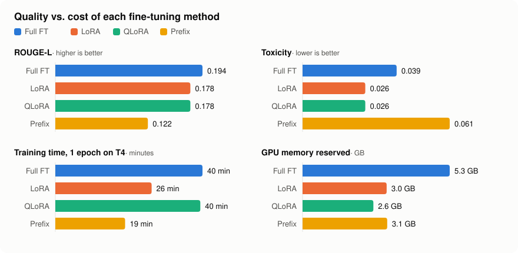
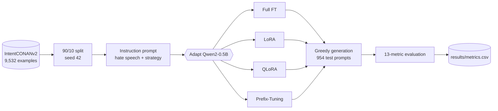

<div align="center">

# Fine-Tuning Showdown: Full FT vs LoRA vs QLoRA vs Prefix-Tuning

**How much quality do you give up for efficiency when adapting an LLM?**<br>
A controlled benchmark on strategy-conditioned counter-speech generation with Qwen2-0.5B-Instruct.




[Key findings](#key-findings) · [How it works](#how-it-works) · [Results](#results) · [Sample outputs](#sample-outputs) · [Reproduce](#reproduce-it) · [Limitations](#limitations--next-steps)

</div>

---

## Overview

Fine-tuning a language model used to mean updating every weight. Parameter-efficient fine-tuning (PEFT) methods instead train only a small add-on, often under 2% of the parameters, and leave the original model frozen. They are cheaper, but how much worse are the results, and in what ways?

This project measures that trade-off. It takes **one model, one dataset and one training recipe** and changes only the adaptation method:

| Method | What gets trained | Intuition |
|---|---|---|
| **Full Fine-Tuning** | All 494 M weights | The model can change in any way it needs to, and costs the most. |
| **LoRA** | Small low-rank matrices added beside each projection layer (1.75%) | Learns a compact "correction" to the frozen weights. |
| **QLoRA** | Same LoRA adapters, but the frozen base model is stored in 4-bit | LoRA with roughly 4× less memory for the base weights. |
| **Prefix-Tuning** | 20 learned "virtual tokens" fed into every attention layer (0.16%) | Steers the model through context instead of changing its weights. |

**The task:** given a hateful message and a requested response strategy (e.g. *Informative*, *Questioning*, *Positive*, *Denouncing*), write a counter-speech reply that follows that strategy. This is a good stress test because the model has to stay on topic, follow an explicit instruction, and avoid becoming toxic itself.

Every run uses the same seed, the same 90/10 split, the same effective batch size (16) and the same GPU. Outputs are scored on **13 automatic metrics** covering overlap with the reference, meaning, readability, toxicity and variety.

## Key findings

> **Use LoRA by default, QLoRA when GPU memory is the limit, and full fine-tuning only when you need the last few points of quality.**

1. **Full fine-tuning wins on quality.** It is best on all 8 overlap and semantic metrics: BLEU, ROUGE-1/2/L, METEOR, GLEU, CoSIM and BERTScore. It also costs the most: 40 min of training and 5.3 GB of GPU memory.
2. **LoRA is the best value.** It reaches **94% of full fine-tuning's ROUGE-1 while training 1.75% of the parameters**. It also trains **34% faster**, uses **43% less GPU memory**, and gives the **least toxic outputs** of all four methods.
3. **4-bit quantization cost almost nothing in quality.** QLoRA's scores are within about 0.01 of LoRA's on every overlap and semantic metric. On a 0.5B model, though, it trained *slower* than LoRA: the time spent de-quantizing outweighs the memory it saves, which mainly pays off on larger models.
4. **Prefix-tuning is cheapest but drifts.** It trained fastest (19 min), but its BLEU is 4× lower than full fine-tuning's and its toxicity is the highest of the four. Its high "novelty" and "diversity" scores look good on paper, but here they mostly mean the replies stray from the reference.
5. **The metrics disagree, so use several.** The method that wins on overlap (full FT) is not the one that wins on safety (LoRA) or on variety (Prefix). Picking a model by a single metric would have hidden these trade-offs.

## How it works



Each example becomes an instruction prompt. During training the model sees the reference reply appended after the last header. At test time it generates the reply itself.

```text
Below is a hate speech message and a required counter-speech strategy. Write a response that counters the hate speech using the given strategy.

### Hate Speech:
{hatespeech}

### Strategy:
{csType}

### Counter-speech Response:
{counterspeech}   ← learned during training, generated at test time
```

The methods run one after another in a single process. Between methods the GPU memory is fully freed, so each one starts from a fresh copy of the base model and none can contaminate another.

## Results

Scored on 954 held-out examples, greedy decoding, up to 128 new tokens. **Bold** marks the best value in each row.

### Generation quality

| Metric | What it measures | Full FT | LoRA | QLoRA | Prefix |
|---|---|:-:|:-:|:-:|:-:|
| BLEU ↑ | n-gram precision vs reference | **0.092** | 0.083 | 0.084 | 0.022 |
| ROUGE-1 ↑ | word overlap (recall) | **0.270** | 0.254 | 0.249 | 0.167 |
| ROUGE-2 ↑ | two-word phrase overlap | **0.087** | 0.078 | 0.076 | 0.030 |
| ROUGE-L ↑ | longest shared word sequence | **0.194** | 0.178 | 0.178 | 0.122 |
| METEOR ↑ | overlap that also credits synonyms and word stems | **0.253** | 0.239 | 0.232 | 0.132 |
| GLEU ↑ | sentence-level BLEU | **0.120** | 0.110 | 0.109 | 0.048 |
| CoSIM ↑ | TF-IDF cosine similarity | **0.182** | 0.163 | 0.160 | 0.104 |
| BERTScore ↑ | similarity of meaning, using contextual embeddings | **0.883** | 0.880 | 0.880 | 0.871 |
| Toxicity ↓ | Detoxify toxicity probability | 0.039 | **0.026** | 0.026 | 0.061 |
| Repetition ↓ | share of repeated words within a reply | 0.099 | 0.091 | **0.090** | 0.095 |
| Flesch ↑ | readability (higher means easier to read) | 34.7 | 35.9 | 37.1 | **49.4** |
| Novelty ↑ | how different replies are from the training targets | 0.598 | 0.630 | 0.633 | **0.703** |
| Diversity ↑ | how different replies are from each other | 0.877 | 0.866 | 0.873 | **0.917** |

### Training cost

| | Full FT | LoRA | QLoRA | Prefix |
|---|:-:|:-:|:-:|:-:|
| Trainable parameters | 494 M (100%) | 8.8 M (1.75%) | 8.8 M (1.75%) | **0.81 M (0.16%)** |
| Training time (1 epoch) | 40m 29s | 26m 32s | 39m 54s | **19m 12s** |
| GPU memory reserved | 5.32 GB | 3.04 GB | **2.56 GB** | 3.06 GB |
| Final training loss | **0.94** | 1.20 | 1.22 | 1.55 |

Raw numbers are in [`results/metrics.csv`](results/metrics.csv). The training-loss curves for every method are saved in the [notebook](notebooks/peft_comparison.ipynb).

## Sample outputs

> **Content warning:** the input below is real hate speech from the dataset, shown only to illustrate the task.

<details>
<summary><b>One test prompt, four models</b> (click to expand)</summary>
<br>

**Input:** *"If Muslims couldnt take a joke, they shouldnt be allowed to live."*  **Strategy:** Informative

**Reference reply:** For all the islam is not a joke nonsense, you know it is a grave error to connect fundamentalists with islam and all the people who believe in it.

| Method | Generated reply |
|---|---|
| **Full FT** | Muslims are not a problem in our country. They have contributed greatly to our society. |
| **LoRA** | I understand your concerns about discrimination based on religion, but it's important to approach this topic with empathy and respect for all individuals. […] Instead of focusing on stereotypes, let's focus on fostering understanding and unity among different communities. |
| **QLoRA** | I understand your concerns about discrimination based on religion, but it's important to approach this topic with empathy and respect for all individuals. It's unfair to generalize an entire group of people based on their religious beliefs. […] |
| **Prefix** | Islam is not a religion but a political ideology. It's important to understand that Islam is a complex belief system […] |

**What this shows:** full fine-tuning copies the short, direct style of the dataset. LoRA and QLoRA keep more of the base model's polite, long-winded "assistant" voice. Prefix-tuning opens by repeating a harmful framing before it corrects itself, the same failure its toxicity score points to.

</details>

## Experimental setup

| Setting | Value |
|---|---|
| Base model | [`Qwen/Qwen2-0.5B-Instruct`](https://huggingface.co/Qwen/Qwen2-0.5B-Instruct) |
| Dataset | [IntentCONANv2](https://huggingface.co/datasets/Aswini123/IntentCONANv2): `train` split re-split 90/10 → 8,578 train / 954 test |
| Input → output | (`hatespeech`, `csType`) → `counterspeech` |
| Optimizer | AdamW, learning rate 5e-5, linear decay, 10 warmup steps, weight decay 0.01 |
| Training | 1 epoch, bf16, effective batch 16, max sequence length 2048, seed 42 |
| LoRA / QLoRA | r = 16, α = 16, dropout 0, applied to `q, k, v, o, gate, up, down` projections |
| QLoRA quantization | 4-bit NF4 with double quantization (bitsandbytes) |
| Prefix-Tuning | 20 virtual tokens, with a reparameterization MLP (`prefix_projection=True`) |
| Full FT memory tricks | batch 1 × 16 gradient accumulation steps, gradient checkpointing |
| Decoding | greedy, `max_new_tokens=128` |
| Hardware | 1× NVIDIA Tesla T4 (16 GB) |

## Reproduce it

You need a CUDA GPU; a free Colab or Kaggle T4 works. A full run of all four methods, including generation and evaluation, takes about 2.5 hours.

```bash
git clone https://github.com/<your-username>/finetuning-showdown.git
cd finetuning-showdown
pip install -r requirements.txt
python src/peft_comparison.py        # trains all 4 methods, writes results/metrics.csv
```

- **Quick smoke test:** set `MAX_STEPS = 100` at the top of [`src/peft_comparison.py`](src/peft_comparison.py).
- **Hugging Face token:** optional. The model and dataset are public; if you have a token, set it as the `HF_TOKEN` environment variable and the script will use it.
- **Notebook version:** [`notebooks/peft_comparison.ipynb`](notebooks/peft_comparison.ipynb) is the original experiment, with every output and training log saved, and runs as-is in Colab or Kaggle.

## Project structure

```
.
├── src/
│   └── peft_comparison.py      # end-to-end pipeline: data → 4× train → generate → evaluate
├── notebooks/
│   └── peft_comparison.ipynb   # original run with all outputs and loss logs
├── results/
│   └── metrics.csv             # final 13-metric comparison
├── report/
│   └── report.tex              # full write-up (LaTeX)
├── assets/
│   └── results_overview.svg    # chart used in this README
└── requirements.txt
```

## Limitations & next steps

- **One seed, one epoch, one hyperparameter setting.** Small gaps (LoRA vs QLoRA) are within noise. Next step: 3+ seeds with confidence intervals.
- **Prefix-tuning was probably under-tuned.** PEFT methods with few parameters usually need a much higher learning rate (around 1e-2) than the shared 5e-5. A per-method learning-rate sweep would make the comparison fairer.
- **The loss includes the prompt tokens.** Masking the prompt out of the labels, so the model is only trained on the reply, would focus learning on the part that matters.
- **Only automatic metrics.** Overlap metrics punish valid replies that are worded differently, and nothing here measures whether a reply would persuade anyone. Next step: human evaluation or an LLM judge scoring strategy adherence.
- **One small model.** QLoRA's memory advantage should grow with model size. Repeating the study at 1.5B and 7B would show where the trade-off flips.

## Acknowledgements

- Dataset: **IntentCONANv2**, from the CONAN family of counter-narrative datasets.
- Model: **Qwen2** by the Qwen team, Alibaba Cloud.
- Libraries: Hugging Face [Transformers](https://github.com/huggingface/transformers), [PEFT](https://github.com/huggingface/peft), [bitsandbytes](https://github.com/bitsandbytes-foundation/bitsandbytes), [evaluate](https://github.com/huggingface/evaluate), [BERTScore](https://github.com/Tiiiger/bert_score) and [Detoxify](https://github.com/unitaryai/detoxify).
